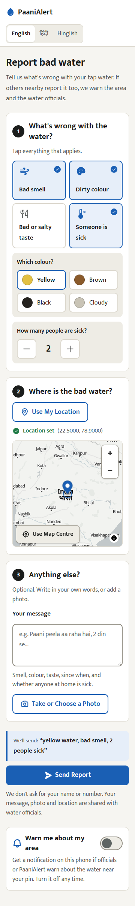
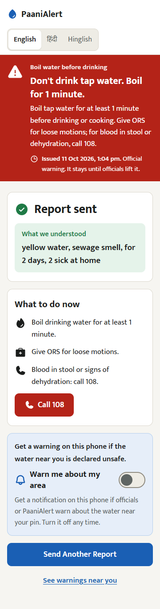
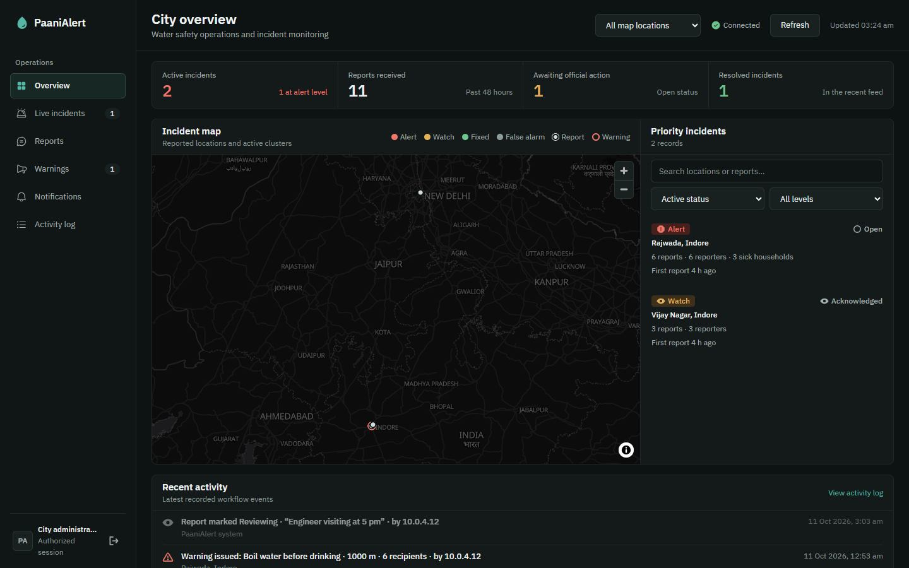
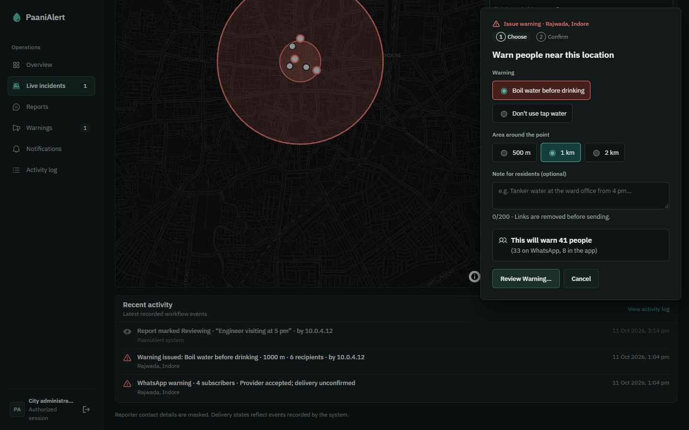

# PaaniAlert

Early warning for unsafe drinking water, from the complaints that come before the hospital cases.

[Demo video](VIDEO_URL) · [Try it](https://main.dy95ki8l9ef8x.amplifyapp.com/report) · [Officials' dashboard](https://main.dy95ki8l9ef8x.amplifyapp.com) · [Public map](https://main.dy95ki8l9ef8x.amplifyapp.com/public) · [Android app](https://github.com/ruthvik418/paanialert/releases/latest/download/PaaniAlert.apk) · [Blog](https://builder.aws.com/content/3KVDhzdtnzTIOfokqoHnDwflBgn/the-complaints-nobody-connected) · [Chat on WhatsApp](https://wa.me/14155238886?text=join%20either-tried)

**Dashboard Access Key** - 72f298f32f78b3cd4adfabaf

Built by Team Crystal Red for the WeMakeDevs × AWS Environmental Hacks, Oct 8–11, 2026 (Heat and Water track).

## Try it in 2 minutes (for judges)

1. **Report.** Open https://main.dy95ki8l9ef8x.amplifyapp.com/report on a phone. Tap what's wrong (smell, colour, taste, someone sick), type, or hold the button and say it in Hindi or English; set the location and send. To install it, use the [Android app](https://github.com/ruthvik418/paanialert/releases/latest/download/PaaniAlert.apk), or open the link on Android Chrome and tap **Add to Home Screen**, which works today.
2. **Officials' dashboard.** https://main.dy95ki8l9ef8x.amplifyapp.com. The access key is in our submission form. Open the Alert in Indore (Rajwada), look at its reports, try **Issue Warning** (choose a radius, see who it would reach, confirm) and **Lift**, then open the **Activity log** to see every step.
3. **Public map.** https://main.dy95ki8l9ef8x.amplifyapp.com/public shows what residents see: rounded clusters and official warnings, no report text.
4. **WhatsApp (optional).** Message +1 (415) 523-8886 on WhatsApp. Your first message must be `join either-tried` (this joins our Twilio sandbox). Then send a complaint in Hindi, English or Hinglish, as text, a photo, a location pin or a voice note. Try: `Nal ka paani peela aa raha hai, badboo hai, 2 din se`. Sandbox access lasts 72 hours; send the join message again if the bot stops replying. [Chat on WhatsApp](https://wa.me/14155238886?text=join%20either-tried)

The Indore clusters on the dashboard are test data (made-up phone hashes, marked "TEST REPORT"), so nobody is messaged because of them.

The Android app is a Trusted Web Activity: it opens the live `/report` page, so it already has voice reports and every later change without a rebuild.

<p>
  
  
</p>




## Why

In December 2025, sewage leaked into a drinking-water pipeline in Bhagirathpura, Indore. Dozens died: the health department was told of 35 deaths in the area and linked 22 to the water; about 1,400 fell ill. Residents had complained about foul-smelling water from mid-December, and on 25 December about water with an unusual smell, before the first illnesses on 27 December. The complaints were scattered and nobody connected them. On 1 October 2026 the judicial commission reported that the tragedy "could have been prevented" ([DT Next](https://www.dtnext.in/news/national/indore-water-linked-deaths-preventable-pipeline-tender-delays-contributed-to-tragedy-judicial-panel)). Every number here is sourced in [`docs/sources.md`](docs/sources.md).

Disease surveillance reacts once patients reach hospitals. Complaints about the water come days earlier. PaaniAlert moves the alarm to the complaints.

## How it works

1. **Report.** A resident messages the WhatsApp bot, or opens the web report page (`/report`) with no sign-up. They can tap tiles, type, send a photo or a location pin, or speak: WhatsApp voice notes and web recordings are transcribed by Amazon Transcribe (Hindi or Indian English, detected automatically), and the reply starts with "I heard: …" so they can check it. A model on Amazon Bedrock fills in the smell, colour, taste, how long it has been happening and whether anyone is sick; code saves the report and replies in English, Hindi or Hinglish with conservative advice (boil water, ORS, call 108 for blood in stool or dehydration). WhatsApp asks for a location pin if there isn't one.
2. **Detect.** Every 15 minutes a cluster check looks at each area (a ~1.2 × 0.6 km cell and its neighbours) over the last 48 hours. 3+ distinct phones (or enough severity) is a **Watch**; 5+ distinct phones or 2+ households with someone sick is an **Alert**.
3. **Alert.** On an Alert, WhatsApp subscribers in the area get a boil-water advisory as text, browsers that turned on "Warn me about my area" get a web push notification, and the ward engineer gets an email (Amazon SNS). If nobody acknowledges it within 24 hours, the district health officer is emailed too.
4. **Act.** Officials review reports on the dashboard and mark them reviewing, resolved or false (false reports leave the cluster rule). They can issue a boil-water or do-not-use warning for a 500 m, 1 km or 2 km circle, which goes to the WhatsApp and push subscribers inside it, and lift it with an all-clear to the same people. Marking an alerted cluster fixed sends an all-clear too. Every alert, message, email and status change is in the Activity log.

## Results

**Reading messages** (`docs/eval.md`): 50 labelled messages (Hindi in Roman and Devanagari script, English, Hinglish with typos, negations); a message counts only if all five fields are right.

| How a message is read | All five fields right | Median time |
|---|---|---|
| Keyword rules (`src/agent/fallback.py`), before tuning | 33/50 (66%) | instant |
| Agent decides when to call a save tool (Bedrock, Oct 10) | 19–21/50 (38–42%) | 3.0 s |
| **Forced structured extraction, code saves** (Qwen3 235B on Bedrock) | **45–46/50 (90–92%)** | **1.2 s** |

Caveat: these 50 messages were also used to write the keyword rules and the field descriptions, so the numbers overstate real accuracy; a fresh holdout set written by someone who hasn't seen the rules is still to be scored.

**Indore replay** (`docs/replay.md`). **SIMULATION**: synthetic reports shaped on the Bhagirathpura timeline, run through the real cluster rule. Assumed: 1,000 households on the supply, 2–10% of them report once, mostly from 25 Dec, 60% of those after 27 Dec mention sickness.

| Adoption | Reporting households | First Watch | First Alert | Alert before the first illness (27 Dec), 100 seeds: median (range) |
|---|---|---|---|---|
| 2% | 20 | 25 Dec 17:00 | 26 Dec 15:00 | 0.5 days (−1.4 to 1.4); before it in 90 of 100 runs |
| 5% | 50 | 25 Dec 12:00 | 26 Dec 08:00 | 1.4 days (0.6 to 10.2) |
| 10% | 100 | 16 Dec 11:00 | 25 Dec 12:00 | 1.6 days (1.4 to 11.1) |

The three false-alarm cases (one person sending 10 complaints, murky water that clears quickly after supply resumes, and complaints inside an announced maintenance area) all stayed at Watch. The usual lead is about a day and a half, not weeks; it does not show that people would have used PaaniAlert or that acting earlier would have saved lives.

## Safety model

- **The model reads, code decides.** The model only fills report fields (a forced structured output). Code decides what counts as a complaint, saves it and writes every reply from fixed templates; a guard strips any model reply that calls the water "safe". If no model answers, keyword rules still save the report.
- **Distinct phones, not message counts.** One person sending many messages can reach Watch at most.
- **Maintenance cap.** An announced maintenance notice in the area caps a cluster at Watch.
- **False reports excluded.** Reports officials mark false leave the cluster rule at the next check.
- **Phone numbers are hashed** (HMAC) in reports. The dashboard shows a masked number and WhatsApp name; the full number is only in a separate Contacts table, read through one audited endpoint.
- **The public page shows only clusters rounded to about 100 m** and active official warnings, with no report text or identities.
- **Two-step warnings.** Officials choose a circle, see how many people it would reach, then confirm. Lifting sends the all-clear to exactly the people who were warned.
- **Quotas and throttling.** Each web device can send 10 reports a day; the public routes are throttled at API Gateway.
- **No stored model keys.** Bedrock is called with short-lived tokens signed from the Lambda's IAM role.
- **Processing stays in Mumbai.** Bedrock, Transcribe, Location and storage all run in `ap-south-1`. (WhatsApp messages reach us through Twilio.)
- **Media is deleted after 7 days** (photos, voice notes, transcripts).

## Limitations

- Voice reports take about 30–45 seconds, because Amazon Transcribe batch jobs have a fixed start-up time. Streaming transcription would be near-instant and is the next step. If a recording can't be transcribed, the bot asks the person to type instead.
- WhatsApp runs on the Twilio sandbox: people must send the join message first, access lasts 72 hours, and WhatsApp only lets us message someone within 24 hours of their last message, so alerts to quiet subscribers can fail (each failure is logged).
- Web reports come from an anonymous device id, which can be faked; the daily quota and the distinct-phones rule limit the damage but don't prevent it.
- The cluster thresholds are untested in the field; the replay is a simulation.
- Extraction accuracy is measured on our own test set (see the caveat above).
- Push warnings on iPhone need the page added to the Home Screen first (iOS 16.4+). Older Safari can't record WebM, so the record button is hidden there.

## Architecture

```
WhatsApp (Twilio) ─► API Gateway ─► Lambda webhook (instant reply) ─► SQS ─► Lambda worker
                                                                              ├─ Amazon Transcribe (voice notes)
                                                                              ├─ Amazon Bedrock, bedrock-mantle, ap-south-1 (Qwen3)
                                                                              ├─ Amazon Location Service (place names)
                                                                              └─ DynamoDB (reports, sessions) · S3 (media, 7 days)
Web report page /report ─► API Gateway ─► Lambda (same worker logic; photos and recordings to S3 by presigned PUT)
                                            └─ recordings: 202 ─► SQS ─► worker (Transcribe) ─► page polls the result
EventBridge (every 15 min) ─► Lambda cluster check ─► SNS email (ward engineer; health officer after 24 h)
                                                   └─ WhatsApp advisories + web push (subscribers in the area)
Officials' dashboard (Amplify) ◄─► API Gateway ◄─► Lambda API ─► warnings and all-clears (WhatsApp + web push)
                                                              ├─ Activity table (every alert, message and status change)
                                                              └─ AuditLog (every time a full number is shown)
Public map /public ◄─ public routes (rounded clusters, active warnings)
Deployed with AWS SAM · logs in CloudWatch · region ap-south-1 (Mumbai)
```

## AWS services

| Service | What it does here |
|---|---|
| AWS Lambda | Webhook, worker, web report API, cluster check, dashboard API |
| Amazon API Gateway (HTTP API) | Twilio webhook, web report routes (throttled), dashboard API |
| Amazon SQS | Queue between the webhook (or a web voice report) and the worker, with a dead-letter queue |
| Amazon Bedrock | Reads each message into report fields (Qwen3 235B, Qwen3 VL as backup) through `bedrock-mantle` in Mumbai |
| Amazon Transcribe | Batch transcription of WhatsApp voice notes (OGG/Opus) and web recordings (WebM/Opus), Hindi or Indian English |
| Amazon DynamoDB | Reports, clusters, subscribers, sessions, warnings, Activity, AuditLog, contacts, quotas |
| Amazon S3 | Photos, voice notes and transcripts, deleted after 7 days |
| Amazon Location Service | Place names for pins; map tiles on the dashboard and resident pages |
| Amazon SNS | Emails to the ward engineer and the district health officer |
| Amazon EventBridge | Runs the cluster check every 15 minutes |
| AWS Systems Manager Parameter Store | Secrets (Twilio, HMAC key, dashboard key, web push keys) |
| AWS Amplify Hosting | Officials' dashboard, public map and web report page |
| Amazon CloudWatch | Logs for every function |
| AWS IAM | One least-privilege role per function; short-lived Bedrock tokens |

## Run it yourself

Prerequisites: Python 3.12, Node.js 20+, AWS CLI v2, AWS SAM CLI, and an AWS profile (`paani` in the scripts) in `ap-south-1` with Bedrock model access.

```bash
python -m venv .venv && source .venv/bin/activate     # Windows: py -3.12 -m venv .venv; .venv\Scripts\Activate.ps1
pip install -r requirements-dev.txt
pytest                                                 # fake AWS (moto); no account needed
cd dashboard && npm ci && npm run build
```

Secrets go in SSM Parameter Store as SecureStrings under `/paanialert/`: `hmac_secret`, `dashboard_key`, `twilio_account_sid`, `twilio_auth_token`, and `vapid_public_key` / `vapid_private_key` for web push. On Git Bash, prefix `aws ssm` commands with `MSYS_NO_PATHCONV=1`.

```bash
py -3.12 scripts/deploy_backend.py      # sam build + deploy (add --layer after changing layer/requirements.txt)
python scripts/deploy_dashboard.py      # build the dashboard and publish it on Amplify
```

Then paste the stack's `WebhookUrl` output into the Twilio WhatsApp sandbox ("When a message comes in", POST), and subscribe officials' emails to the `WardEngineerTopicArn` and `HealthOfficerTopicArn` outputs.

Test data without real phones (made-up phone hashes, so nobody is messaged for them):

```bash
python scripts/fake_reports.py --near 22.7186,75.8553 --phones 6 --sick 2 --area "Rajwada, Indore"           # an Alert
python scripts/fake_reports.py --near 22.7533,75.8937 --phones 3 --area "Vijay Nagar, Indore" --check       # a Watch
python scripts/fake_reports.py --clean                                              # remove all test data
```

`/health` returns `{"ok": true}`. Everything is serverless, so the stack stays live until it is deleted.

## Repo layout

| Path | What |
|---|---|
| `template.yaml` | Every AWS resource (AWS SAM) |
| `src/webhook/` | Twilio webhook: check the signature, queue, reply instantly |
| `src/worker/` | Queue consumer: transcribe, read, save, reply |
| `src/agent/` | Prompts and fixed replies, Bedrock extraction, keyword fallback, Transcribe, media |
| `src/api/` | Dashboard API, warnings, web report API |
| `src/cluster/` | The cluster rule (pure function) and the scheduled check |
| `src/common/` | Records, DynamoDB helpers, geohash, hashing, place names, web push, Twilio |
| `dashboard/` | React + MapLibre: officials' dashboard, `/public`, `/report` (installable PWA) |
| `data/` | Labelled test messages and the replay data (SIMULATION) |
| `scripts/` | Deploy, test data, replay, extraction eval |
| `tests/` | Unit tests against fake AWS |
| `docs/` | Sources, eval, replay, Bedrock access, Android app, screenshots |

## Team

Team Crystal Red: J Lokesh Rao, Jaya Ruthvik Parasu, Shrikar Tadkasat.
